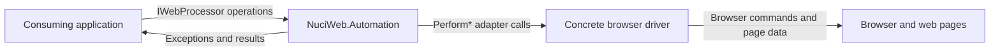
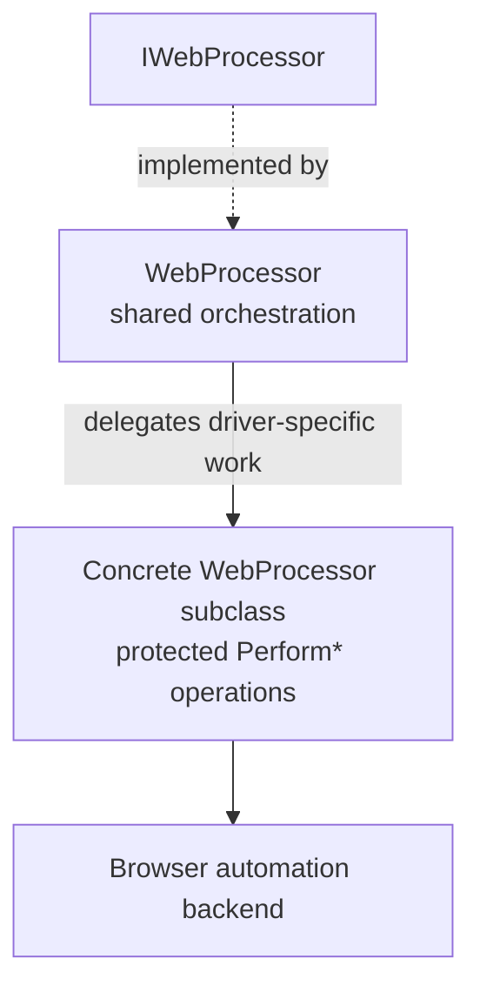
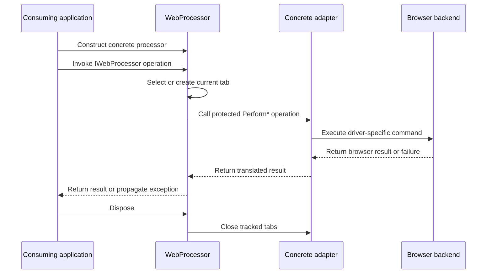
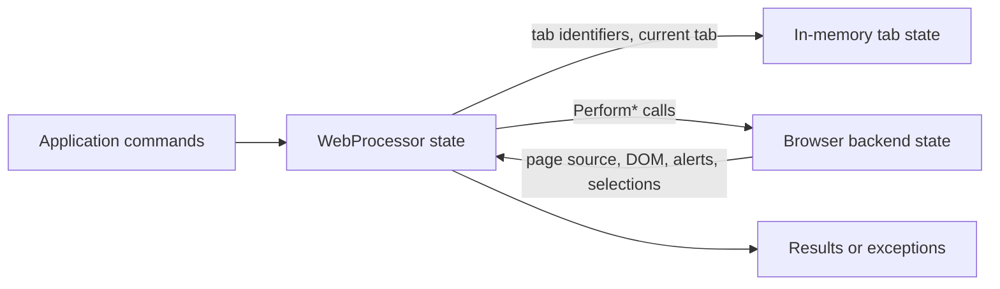
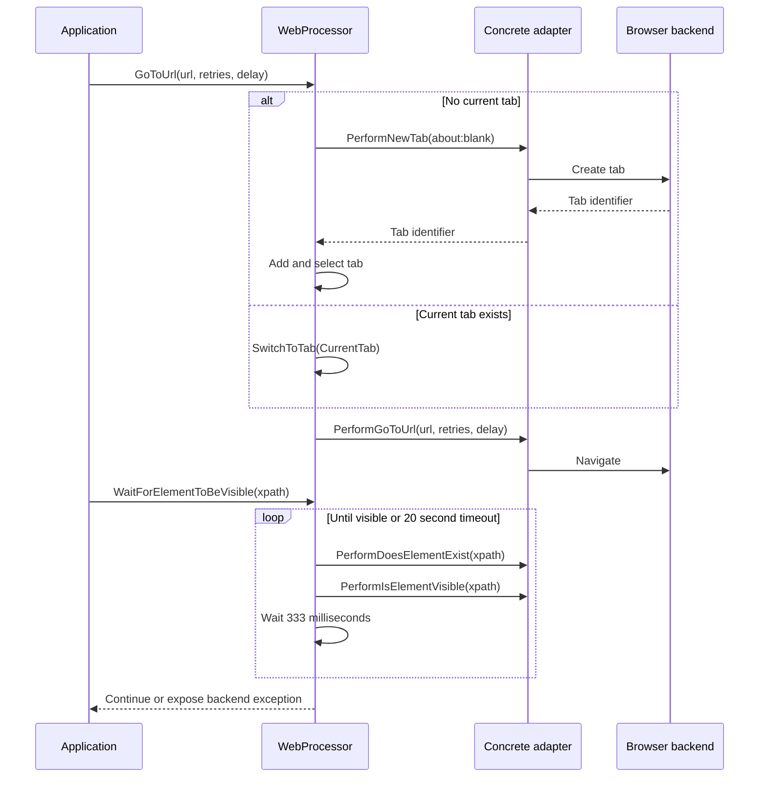
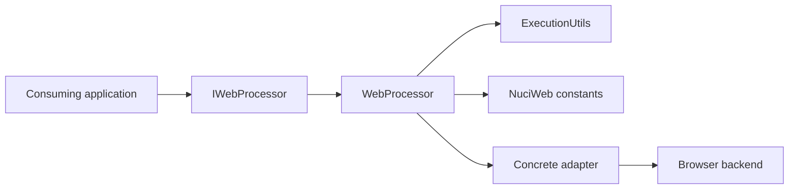

# NuciWeb.Automation Architecture

This document describes the current architecture of the NuciWeb.Automation .NET library. It covers the public automation contract, shared orchestration, browser-driver boundary, runtime state, and verification scope; browser-driver implementations and consuming applications are outside this repository.

## 📑 Table of Contents

- [Purpose](#purpose)
- [System Context](#system-context)
- [Architectural Style](#architectural-style)
- [Runtime Flow](#runtime-flow)
- [Components](#components)
- [Data Architecture](#data-architecture)
- [Interfaces and Integrations](#interfaces-and-integrations)
- [Key Flows](#key-flows)
  - [Navigation and Element Interaction](#navigation-and-element-interaction)
- [Cross-Cutting Concerns](#cross-cutting-concerns)
  - [Security and Privacy](#security-and-privacy)
  - [Error Handling](#error-handling)
  - [Concurrency and Resource Use](#concurrency-and-resource-use)
- [Dependency Direction and Rules](#dependency-direction-and-rules)
- [External Dependencies](#external-dependencies)
- [Deployment and Operations](#deployment-and-operations)
- [Compatibility Contracts](#compatibility-contracts)
- [Testing and Verification](#testing-and-verification)
- [Design Constraints](#design-constraints)
- [Extension Points](#extension-points)
  - [Browser Processor Implementation](#browser-processor-implementation)
- [Architecture Decisions](#architecture-decisions)
- [Source Map](#source-map)
- [Related Documentation](#related-documentation)

## 🎯 Purpose

NuciWeb.Automation provides a reusable, backend-agnostic abstraction for browser automation. This document records the system boundary, ownership rules, public contracts, and runtime behavior for maintainers and contributors so that changes can be evaluated against the library's stable extension points.

## 🌐 System Context

The library is an in-process component embedded in a consuming application. The application creates a concrete `WebProcessor`; that implementation translates the shared orchestration calls into operations on an external browser automation backend. The library does not own a browser process, application database, or persistent store.



The principal external boundaries are:
- **Consuming application:** Owns composition, user workflow, credentials, and handling of returned results and exceptions.
- **Concrete browser driver:** Owns driver-specific browser commands and implements the protected `Perform*` operations required by `WebProcessor`.
- **Browser and web pages:** Supply remote page content and browser state through the selected driver; network behavior is outside this repository.

## 🏗️ Architectural Style

The library combines a public abstraction with a template-method base class and adapter boundary. `IWebProcessor` defines the consumer-facing contract, while `WebProcessor` implements shared tab management, waits, retries, convenience methods, and lifecycle behavior. Concrete subclasses provide driver-specific behavior through protected `Perform*` methods.



The principal architecture boundaries are:
- **Public contract:** Defines operations, properties, and disposal semantics consumed by application code.
- **Shared orchestration:** Owns tab bookkeeping, default timing, retry policy, convenience operations, and delegation order.
- **Driver adapter:** Owns translation from protected `Perform*` methods to a concrete browser automation backend.
- **External browser boundary:** Owns browser sessions, page execution, DOM state, alerts, and remote navigation.

## 🔄 Runtime Flow



The principal runtime sequence is:
1. The consuming application constructs a concrete `WebProcessor` implementation.
2. The application invokes a public `IWebProcessor` operation.
3. `WebProcessor` selects or creates a tab, applies waits or retries where defined, and delegates driver-specific work.
4. The adapter communicates with the browser backend and returns a result or exception.
5. The application receives the result; disposal closes the tracked tabs.

## 🧩 Components

| Component | Responsibility | Principal Dependencies | Lifetime or Ownership |
|-----------|----------------|------------------------|-----------------------|
| `IWebProcessor` | Stable consumer-facing browser automation contract and `IDisposable` boundary | .NET base types | Owned by consuming application |
| `WebProcessor` | Shared tab state, navigation, DOM helpers, waits, retries, selection, and disposal orchestration | `IWebProcessor`, `ExecutionUtils`, `NuciWeb` HTML attribute constants | Instantiated by consuming application; state lives for processor lifetime |
| Concrete `WebProcessor` subclass | Implements browser-specific `Perform*` operations | Selected browser automation backend | Owned and composed by consuming application |
| `ExecutionUtils` | Supports retry-until-result behavior used by DOM reads | `WebProcessor`, .NET timing APIs | Stateless utility |
| `NuciWeb.Automation.UnitTests` | Verifies public behavior with test doubles and focused test fixtures | NUnit, Moq, library project | Test-only project |

## 💾 Data Architecture

The library owns transient in-memory processor state only. It tracks browser tab identifiers in `Tabs`, the active identifier in `CurrentTab`, retry preference in `RetryOnDomFailure`, and a `Random` instance used by random option selection. Browser page state and all application data remain owned by the external browser backend or consuming application.



| Data or Store | Owner | Representation and Storage | Lifecycle or Consistency |
|---------------|-------|----------------------------|--------------------------|
| Tab identifiers and current tab | `WebProcessor` | `IList<string>` plus `string`, held in memory | Created, switched, and removed during processor lifetime; closed during disposal |
| Retry and random-selection state | `WebProcessor` | `bool` and `Random` fields/properties | Exists for processor lifetime; no persistence |
| Browser page and DOM state | Concrete adapter and browser backend | Backend-specific browser session state | External to the library; changed by navigation and interaction operations |

## 🔌 Interfaces and Integrations

| Interface or Integration | Direction | Contract | Owner | Failure Semantics |
|--------------------------|-----------|----------|-------|-------------------|
| `IWebProcessor` | Inbound | .NET interface for tabs, navigation, DOM interaction, waits, alerts, selection, and disposal | Library | Invalid tab ownership raises `ArgumentException`; backend failures propagate through the implementation |
| Protected `Perform*` methods | Outbound from shared orchestration | Abstract methods implemented by a concrete `WebProcessor` subclass | Concrete adapter | Adapter-defined browser-driver exceptions propagate to the caller |
| `NuciWeb` HTML attribute names | Inbound dependency | `HtmlAttributeNames` values used for common attribute lookup | `WebProcessor` | Package/API incompatibility can prevent build or alter attribute selection |
| Browser automation backend | Outbound | Backend-specific API selected by the concrete adapter | Consuming application and adapter | Network, browser, DOM, and driver failures are backend-specific |

## 🔀 Key Flows

### Navigation and Element Interaction



Navigation ensures a current tab, then delegates navigation with the configured retry count and delay. Wait helpers poll through the abstraction using a 20-second default timeout and a 333-millisecond default wait. The adapter remains responsible for interpreting URLs, XPath expressions, browser state, and driver failures.

## 🧵 Cross-Cutting Concerns

### Security and Privacy

The library does not authenticate users, authorise application actions, persist secrets, or collect telemetry. It accepts URLs, scripts, XPath expressions, text, and other values from the consuming application and passes relevant values to the concrete adapter. The consuming application and adapter own validation, credential handling, browser permissions, and sensitive-data protection. See [PRIVACY.md](PRIVACY.md) and [SECURITY.md](SECURITY.md).

### Error Handling

Shared orchestration raises argument errors for invalid or unknown tabs and may expose collection or conversion failures from its convenience methods. Backend and browser failures are not normalised into a library-wide exception type; they propagate from the concrete adapter. Wait loops stop when their condition succeeds or the default timeout elapses, without an explicit timeout exception in the shared implementation.

### Concurrency and Resource Use

`WebProcessor` maintains mutable tab state and uses blocking `Thread.Sleep` waits. The implementation provides no synchronization or async API, so a processor instance should be treated as single-threaded unless its concrete adapter adds external coordination. `Dispose` closes the tabs tracked by the processor; browser-driver resources outside those operations remain adapter-owned.

## 🧭 Dependency Direction and Rules

The stable public contract points inward to shared orchestration, and shared orchestration points outward only through protected abstract driver operations. Concrete adapters may depend on browser backends; the library core must not depend on a specific browser implementation.



The principal dependency rules are:
- Consumers depend on `IWebProcessor` or `WebProcessor`, not on library internals.
- `WebProcessor` owns shared workflow and delegates backend-specific operations through `Perform*` methods.
- Concrete adapters may depend on browser automation backends; the core library does not select or instantiate one.
- No library component persists application data or owns the consuming application's composition root.

## 📦 External Dependencies

| Dependency | Responsibility | Integration Boundary | Architectural Consequence |
|------------|----------------|----------------------|---------------------------|
| .NET 10.0 runtime and base class libraries | Runtime types, collections, timing, disposal, and threading | Public contract and `WebProcessor` | The package targets `net10.0` and requires that runtime compatibility |
| `NuciWeb` 4.0.0 | Shared HTML attribute-name constants | `WebProcessor` attribute helpers | Attribute lookup depends on this package's API and version |
| NUnit 4.2.2 | Unit-test framework | `NuciWeb.Automation.UnitTests` | Verification is organized as NUnit tests |
| Moq 4.20.72 | Test doubles for processor behavior | `NuciWeb.Automation.UnitTests` | Tests can isolate shared orchestration from browser implementations |

## 🚀 Deployment and Operations

NuciWeb.Automation is packaged as a NuGet library and runs in the host process of a consuming .NET application. It has no independent service process, deployment topology, persistent store, scheduler, or operator-facing endpoint. The consuming application supplies the concrete browser adapter and is responsible for the browser runtime, network access, and process lifecycle.

| Concern | Current Design | Architectural Consequence |
|---------|----------------|---------------------------|
| Process topology | In-process library referenced by a .NET application | No independent service deployment or scaling unit |
| Distribution | NuGet package `NuciWeb.Automation` | Consumers select and update package versions |
| Persistent state | None owned by the library | Recovery and retention of browser/application data belong to the host and backend |
| Shutdown | Consumer calls `Dispose`; tracked tabs are closed | Correct resource cleanup depends on the adapter honoring `PerformCloseTab` |

## 🛡️ Compatibility Contracts

| Contract | Owner | Invariant | Verification | Change Policy |
|----------|-------|-----------|--------------|---------------|
| `IWebProcessor` public API | `NuciWeb.Automation` | Method names, overloads, properties, and `IDisposable` behavior remain usable by consumers | Unit tests and build | Preserve backward compatibility or make an intentional versioned breaking change |
| `WebProcessor` protected `Perform*` surface | `WebProcessor` and adapter authors | Concrete subclasses can implement every required driver operation | Build and processor test fixtures | Treat changes as extension-point changes requiring adapter updates |
| Tab lifecycle | `WebProcessor` | Created tab identifiers are tracked, selectable, and closed through the abstraction | Tab-management unit tests | Preserve ordering and ownership validation semantics |
| Wait and retry defaults | `WebProcessor` | Default wait is 333 milliseconds; default timeout is 20 seconds; navigation defaults to three attempts | Wait and navigation unit tests | Change only with explicit behavioral review |

## ✅ Testing and Verification

The `NuciWeb.Automation.UnitTests` project uses NUnit and Moq to verify `WebProcessor` behavior through test doubles. Test fixtures cover navigation, tab management, element existence and state, text, interaction, waits, scripts, alerts, and element attributes. The tests verify the shared orchestration boundary; real browser-driver integration is outside the repository's current test project.

Execute the principal automated verification with:

```bash
dotnet test NuciWeb.Automation.UnitTests/NuciWeb.Automation.UnitTests.csproj
```

## ⚠️ Design Constraints

- **Backend agnosticism:** The library cannot provide browser behavior directly; every concrete adapter must implement the protected `Perform*` operations.
- **Synchronous execution:** Waits block the calling thread through `Thread.Sleep`; there is no asynchronous processor contract.
- **Transient state only:** Tabs and processor settings are in-memory and are not recoverable from persistent storage.
- **Adapter-owned failures:** Browser, network, DOM, and driver exception semantics depend on the concrete implementation.
- **Target framework:** The package targets `.NET 10.0`, which constrains consuming runtimes and build environments.

## 🔧 Extension Points

### Browser Processor Implementation

1. Implement or revise the owning `WebProcessor` subclass and its protected `Perform*` operations.
2. Register or integrate the implementation at the consuming application's composition boundary.
3. Add the verification required to preserve neighbouring contracts.

The implementation must preserve tab identifiers, current-tab selection, disposal behavior, synchronous method semantics, and the public `IWebProcessor` contract while translating operations to the selected browser backend.

## 📝 Architecture Decisions

| Decision | Rationale | Consequence | Record |
|----------|-----------|-------------|--------|
| Keep browser-driver operations behind `WebProcessor` protected methods | Shared workflows can remain independent of Selenium, Playwright, or custom driver APIs | Concrete adapters must implement the complete `Perform*` surface | Documented here |
| Keep processor state in memory | The library coordinates an active browser session rather than owning application data | Sessions cannot be restored by the library after process loss | Documented here |
| Provide synchronous wait helpers | The existing consumer contract uses synchronous browser operations and blocking waits | Host threads are occupied during waits | Documented here |

## 🗺️ Source Map

| Area | Path |
|------|------|
| Public automation contract | `NuciWeb.Automation/IWebProcessor.cs` |
| Shared orchestration and lifecycle | `NuciWeb.Automation/WebProcessor.cs` |
| Retry utility | `NuciWeb.Automation/Utils/ExecutionUtils.cs` |
| Unit-test fixtures | `NuciWeb.Automation.UnitTests/` |
| Project and package metadata | `NuciWeb.Automation/NuciWeb.Automation.csproj` |
| Solution definition | `NuciWeb.Automation.slnx` |

## 📚 Related Documentation

- [README.md](README.md) describes capabilities, installation, usage, and package distribution.
- [CONTRIBUTING.md](CONTRIBUTING.md) describes development setup, coding, testing, and contribution workflow.
- [SECURITY.md](SECURITY.md) describes vulnerability reporting, supported versions, scope, and disclosure.
- [PRIVACY.md](PRIVACY.md) describes the library's data-handling boundary.
- [CODE_OF_CONDUCT.md](CODE_OF_CONDUCT.md) describes expected conduct and reporting concerns.
