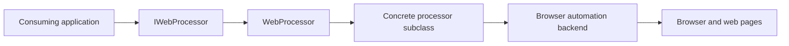

# Architecture

This document complements the root [ARCHITECTURE.md](../ARCHITECTURE.md) with implementation-oriented navigation.

## Boundary model

`IWebProcessor` exposes browser operations to consumers. `WebProcessor` implements reusable orchestration and calls protected abstract `Perform*` methods. A concrete subclass translates those calls to a browser automation backend.

## Ownership

`WebProcessor` owns the ordered `Tabs` collection, `CurrentTab`, retry preference, random selector, default timing, and disposal traversal. The adapter owns driver handles, browser commands, page state, and backend-specific exceptions. No component in this repository owns persistence or a browser process.

## Delegation rule

Public methods should preserve the shared contract and delegate browser-specific work through a `Perform*` member. New backend-specific behaviour belongs in an adapter, not in the core library.
